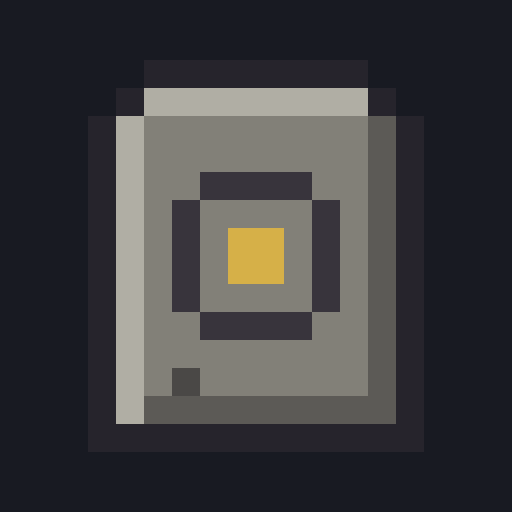
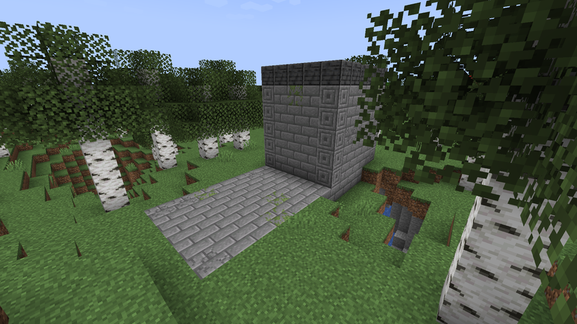

# Atlas of the Vanished

## English

Atlas of the Vanished is a Minecraft mod that adds three ruins to the Overworld and a way to find them. Climb a Watchtower to get a Survey, follow it to a Sealed Crypt or a Buried Temple, bring back their plates and bind them into the Atlas, which keeps a record of every site you find.

- [The guide](en/guide.md): installing, the items, and the path from the first Watchtower to the Atlas
- [The ruins](en/ruins.md): the Watchtower, the Sealed Crypt and the Buried Temple, room by room, with their loot
- [Survey and Atlas](en/survey-and-atlas.md): how the search works, its reach, its limits and its messages
- [Server](en/server.md): configuration, commands, compatibility and known issues

This wiki describes version 0.2.0-alpha.5, an alpha, so rules and numbers can still change. Nobody has played a full game with it yet. The numbers come from the mod's code and data.

## Français

L'Atlas des Disparus est un mod Minecraft qui ajoute trois ruines à l'Overworld, et de quoi les trouver. Grimpez une Tour de Guet pour obtenir un Relevé, suivez-le jusqu'à une Crypte Scellée ou un Temple Enseveli, rapportez leurs plaques et reliez-les dans l'Atlas, qui garde la trace de chaque site découvert.

- [Le guide](fr/guide.md) : installer, les objets, et le chemin de la première Tour de Guet jusqu'à l'Atlas
- [Les ruines](fr/ruines.md) : la Tour de Guet, la Crypte Scellée et le Temple Enseveli, salle par salle, avec leur butin
- [Relevé et Atlas](fr/releve-et-atlas.md) : comment marche la recherche, sa portée, ses limites et ses messages
- [Serveur](fr/serveur.md) : configuration, commandes, compatibilité et problèmes connus

Ce wiki décrit la version 0.2.0-alpha.5, en alpha : les règles et les chiffres peuvent encore changer. Personne n'a encore joué une vraie partie avec. Les chiffres viennent du code et des données du mod.

