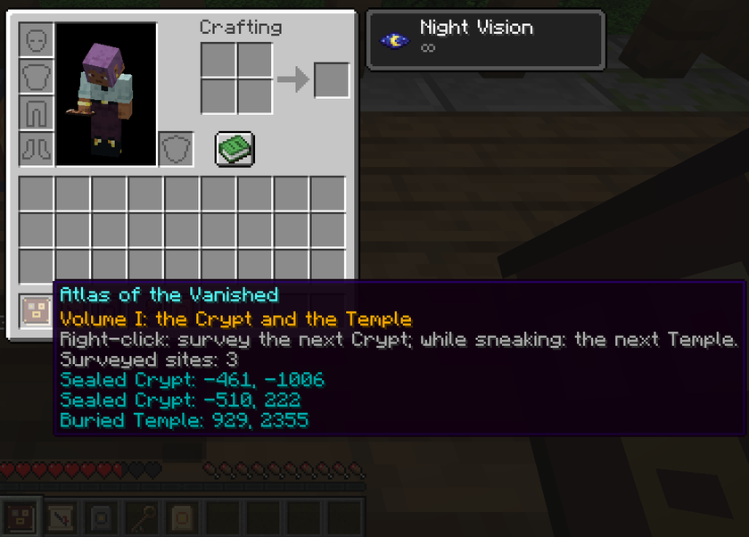

[Home](../README.md) · **Guide** · [Ruins](ruins.md) · [Survey and Atlas](survey-and-atlas.md) · [Server](server.md) · [Français](../fr/guide.md)

# The guide

## Installing

Minecraft 1.21.1, NeoForge 21.1.265 or newer, Java 21. The mod goes on both the client and the server and needs no other mod. It is in English and French; in French it shows up as L'Atlas des Disparus.

The ruins only appear in chunks generated after the mod is installed. On an existing world, travel to unexplored land.

## The items

| Item | Where it comes from | What it does |
|---|---|---|
| Survey | Watchtower chest | Right-click: finds the nearest Sealed Crypt and turns into a map |
| Temple Survey, shown as "Survey (Temple)" | Watchtower chest, one time in two | Same, for the nearest Buried Temple |
| Vanished Key | The trial spawner of a Sealed Crypt | Opens the Vault of the same Crypt |
| Crypt Plate | The Vault of a Sealed Crypt | Ingredient of the Atlas |
| Temple Plate | The chest of a Buried Temple, rarely the suspicious sand | Ingredient of the Atlas |
| Atlas of the Vanished | Crafted | Finds Crypts and Temples again and again, and records them |

## From the first tower to the Atlas

1. **Find a Watchtower.** A stone and spruce tower in forests, taigas, plains, meadows and savannas. Climb the ladder to the lookout platform and open the chest.
2. **Use the Survey.** Hold it and right-click. The search runs in the background; a few seconds later the Survey becomes a map with a red cross on the Crypt.
3. **Clear the Sealed Crypt.** Go down the mausoleum stairs, mind the pressure plates in the corridor, beat the trial spawner to get the Vanished Key, then use the key on the Vault for the Crypt Plate.
4. **Find a Buried Temple.** Use the Temple Survey if the tower gave you one; otherwise look in deserts and badlands. Read the book on the lectern before touching a lever.
5. **Craft the Atlas.** A book, the Crypt Plate and the Temple Plate, in any order, in a crafting table or your inventory grid.
6. **Use the Atlas.** Right-click to find the next Crypt you haven't recorded yet, sneak and right-click for the next Temple. Each search adds the site to the book and gives you its map. The Atlas is never used up.

## Tips

- Bring a bow or a shield for the arrow traps, and some food for the trial spawner fight.
- Bring a brush to the Temple: the sanctuary has six blocks of suspicious sand.
- A Survey keeps working after a failed search: wait 10 seconds and try again somewhere else.
- The Atlas reaches farther than the Survey, so use it for sites the Survey couldn't find.

Details: [the ruins](ruins.md), [Survey and Atlas](survey-and-atlas.md).
