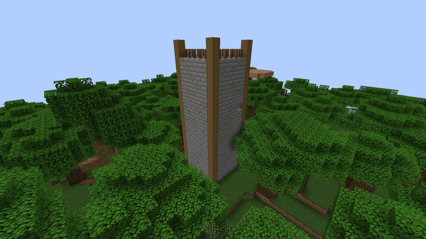
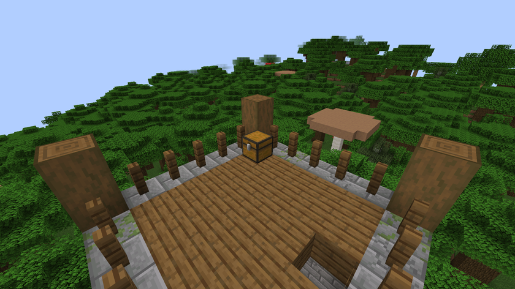
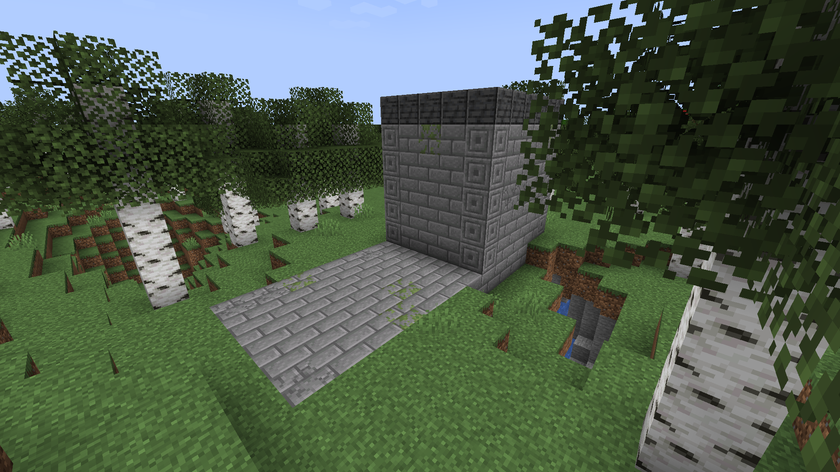
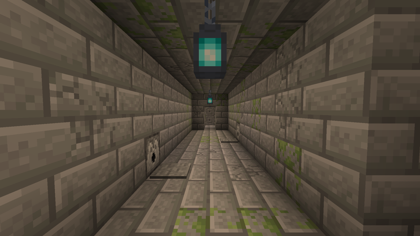
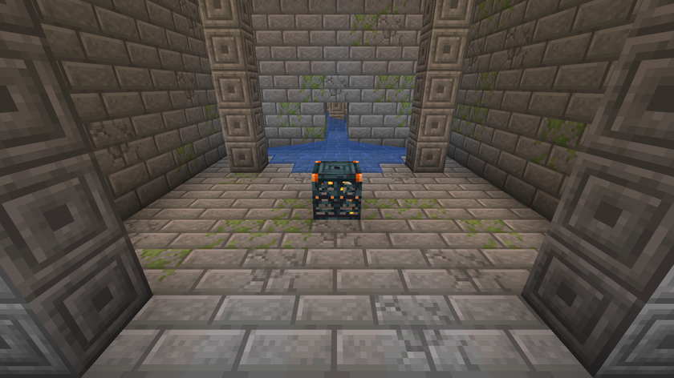
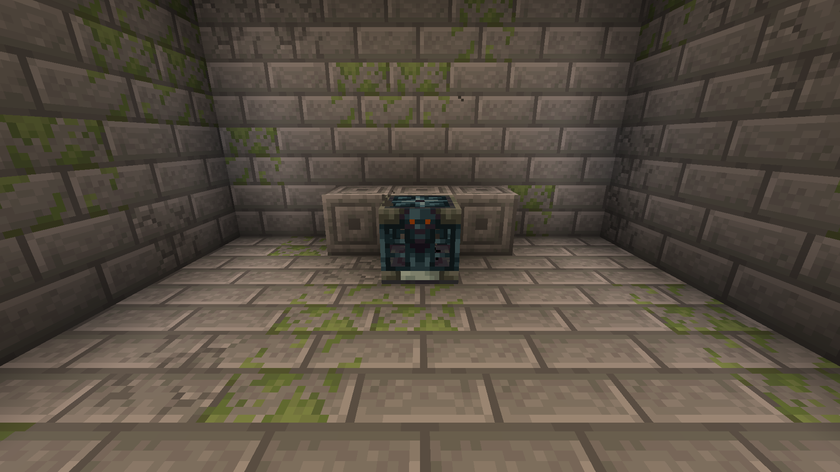
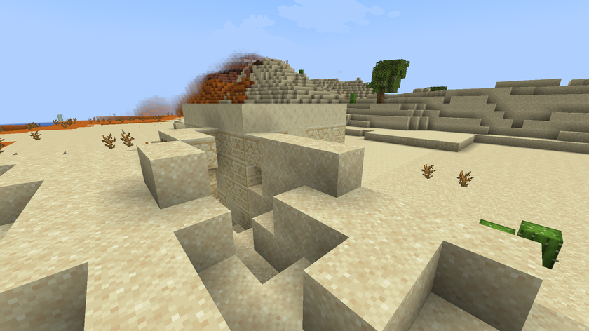
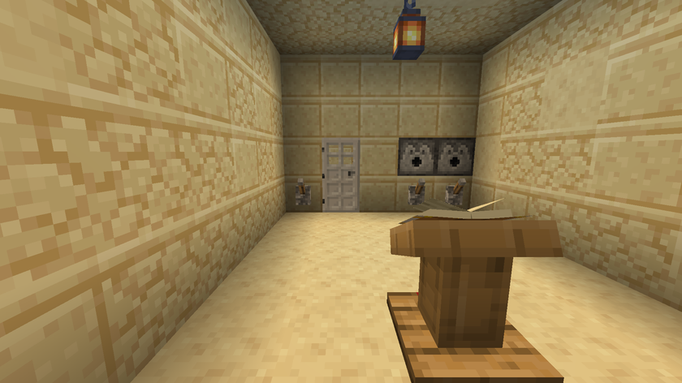
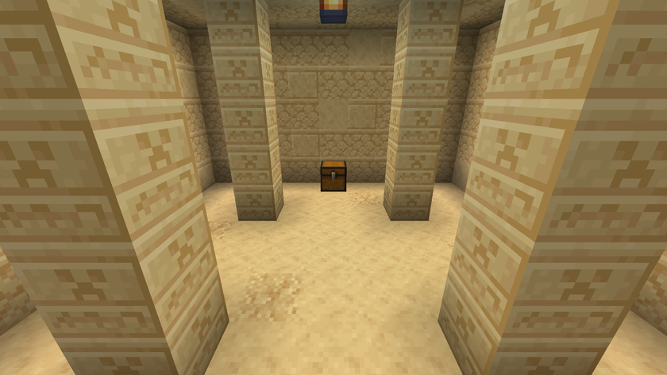

[Home](../README.md) · [Guide](guide.md) · **Ruins** · [Survey and Atlas](survey-and-atlas.md) · [Server](server.md) · [Français](../fr/ruines.md)

# The ruins

All three ruins generate in the Overworld, in new chunks only. "About one every N chunks" means the world is cut into squares of N × N chunks and each square can hold one site, if the biome fits.

In the loot tables below, the weight is the share of each line: a line of weight 4 comes up four times as often as a line of weight 1 in the same roll.

## Watchtower

- **Where:** forests, taigas, plains, sunflower plains, meadows and savannas.
- **How often:** about one every 32 chunks, at least 10 chunks apart.
- **Inside:** a ladder up to the lookout platform, with one chest.

### Lookout chest

| Item | Count | Chance |
|---|---|---|
| Survey | 1 | always |
| Temple Survey | 1 | one time in two |

Plus 2 to 4 rolls among:

| Item | Count | Weight |
|---|---|---|
| Bread | 1 to 3 | 4 |
| Arrows | 4 to 12 | 3 |
| Torches | 4 to 8 | 3 |
| Spyglass | 1 | 1 |
| Compass | 1 | 1 |

## Sealed Crypt

- **Where:** the same biomes as the Watchtower, never within 4 chunks of a village.
- **How often:** about one every 40 chunks, at least 14 chunks apart.
- **Layout:** six rooms in a row, always in the same order.

| # | Room | What's there |
|---|---|---|
| 1 | Mausoleum | A small stone building on the surface; stairs go 8 blocks down |
| 2 | Trapped corridor | Two stone pressure plates, each wired to a dispenser of 16 arrows |
| 3 | Descending turn | The way turns and goes 2 blocks lower |
| 4 | Trial spawner hall | Four pillars and the trial spawner |
| 5 | Antechamber | One more pressure plate and arrow dispenser |
| 6 | Vault room | The Vault that holds the Crypt Plate |

### The trial spawner

| Setting | Value |
|---|---|
| Mobs | skeletons (weight 3) and zombies (weight 2) |
| Total mobs | 6, plus 2 for each extra player |
| At the same time | 2, plus 1 for each extra player |
| Time between spawns | 2 seconds |
| Wakes up when a player is within | 14 blocks |
| Cooldown after a fight | 30 minutes |
| Reward | 1 Vanished Key |

It is a vanilla trial spawner with these settings: beat every mob of the wave and it ejects the key.

### The Vault

Use the Vanished Key on the Vault. It is a vanilla Vault, so each player can open it once.

| Item | Count | Chance |
|---|---|---|
| Crypt Plate | 1 | always |

Plus 2 to 3 rolls among:

| Item | Count | Weight |
|---|---|---|
| Emeralds | 2 to 4 | 5 |
| Iron ingots | 2 to 4 | 4 |
| Golden carrots | 2 to 4 | 3 |
| Bones | 3 to 6 | 3 |
| Diamonds | 1 to 2 | 1 |

## Buried Temple

- **Where:** deserts and badlands.
- **How often:** about one every 48 chunks, at least 16 chunks apart.
- **Layout:** a half-buried sandstone pavilion, stairs 5 blocks down, then two rooms.

### The puzzle room

A lectern holds a book with the clue: page 1 in French, page 2 in English. Three levers stand on the wall by an iron door. One lever opens the door; each of the other two fires a dispenser of 16 arrows.

Solution (spoiler)

The clue reads: "Who enter facing the dawn pull with the left hand only." Facing the levers, pull the one on the left.

### The sanctuary

Six blocks of suspicious sand in the floor, and a chest.

Suspicious sand, one item per block:

| Item | Weight |
|---|---|
| Gold nugget | 4 |
| Archer pottery sherd | 2 |
| Prize pottery sherd | 2 |
| Skull pottery sherd | 2 |
| Emerald | 2 |
| Temple Plate | 1 |

Chest:

| Item | Count | Chance |
|---|---|---|
| Temple Plate | 1 | always |

Plus 3 to 5 rolls among:

| Item | Count | Weight |
|---|---|---|
| Gold ingots | 2 to 5 | 4 |
| Emeralds | 2 to 4 | 3 |
| Lapis lazuli | 4 to 9 | 3 |
| Bones | 2 to 6 | 3 |
| Brush | 1 | 2 |
| Diamonds | 1 to 2 | 1 |
