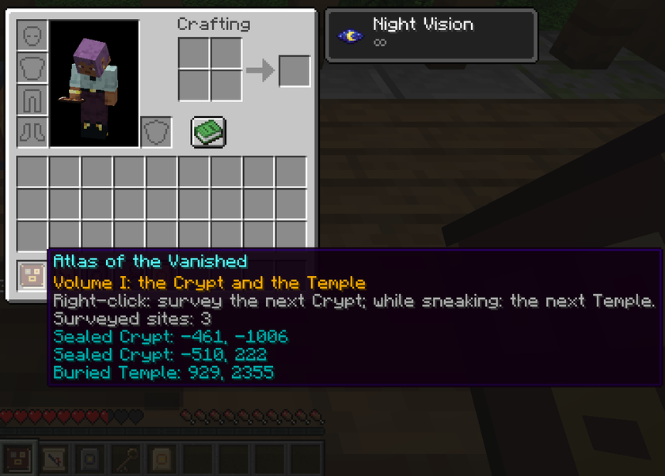

[Home](../README.md) · [Guide](guide.md) · [Ruins](ruins.md) · **Survey and Atlas** · [Server](server.md) · [Français](../fr/releve-et-atlas.md)

# Survey and Atlas

## The Survey

Found in Watchtower chests. A plain Survey looks for a Sealed Crypt; the one named "Survey (Temple)" looks for a Buried Temple.

1. Hold it and right-click. The message bar says the search has started.
2. The search runs in the background, cell by cell outward from where you stand, without freezing the server. You can keep moving and playing.
3. When it finds a site, the Survey turns into a map named "Crypt Survey" or "Temple Survey", with a red cross on the site.

Keep the Survey in your inventory while it searches. If you drop it or put it in a chest, the search is dropped too and nothing happens.

The map is a vanilla map at scale 1:4, centered on the site. It starts blank and fills in as you explore the area, like any map; the red cross and your position show from the start.

## The Atlas of the Vanished

**Recipe (shapeless):** book + Crypt Plate + Temple Plate.

The Atlas uses the same search as the Survey, with two differences:

- **It is never used up.** Each search records the site in the book and adds its map to your inventory (dropped at your feet if your inventory is full).
- **It skips what it already knows.** Each search looks for the nearest Crypt (or Temple) that isn't recorded in this Atlas yet. Use it again and again to find the next site, then the next.

Right-click looks for a Crypt; sneak and right-click looks for a Temple.

Hover over the Atlas to read its record: the title "Volume I: the Crypt and the Temple", how to use it, the number of surveyed sites, then each site with its X and Z coordinates.

## Reach

The search goes outward in rings of the structure's grid (see [how often each ruin appears](ruins.md)). A search that reaches the last ring without finding anything fails.

| | Rings | Sealed Crypt | Buried Temple |
|---|---|---|---|
| Survey | 16 | about 10,000 blocks | about 12,000 blocks |
| Atlas | 24 | about 15,000 blocks | about 18,000 blocks |

## Limits

| Rule | Value |
|---|---|
| Searches at the same time, per player | 1 |
| Searches at the same time, on the whole server | 4 |
| Longest search before it gives up | 150 seconds |
| Wait after a failed search | 10 seconds |

A failed search never costs you the item: you keep the Survey or the Atlas and can try again after the wait. When the server already runs 4 searches, yours is refused at once, without a wait.

## Messages

| Message | Meaning |
|---|---|
| The Survey is looking for the nearest Crypt… | The search has started |
| Survey complete: the Crypt is marked on the map. | Found; the Survey is now a map |
| The Atlas records a new Crypt; its map joins your pack. | Found; the site is in the Atlas |
| A survey is already in progress. | You already have a search running |
| Surveys are saturated; try again later. | The server already runs 4 searches |
| The Survey must wait a little longer. | You are still in the 10-second wait |
| No Crypt within the Survey's reach. | Nothing found in the rings; try somewhere else, or use the Atlas |
| The Survey did not finish in time. | The search took more than 150 seconds |
| No Crypt can exist in this world. | This dimension has no Crypts (the Nether, the End, a world without them) |

The Temple messages are the same with "Temple" in place of "Crypt".
