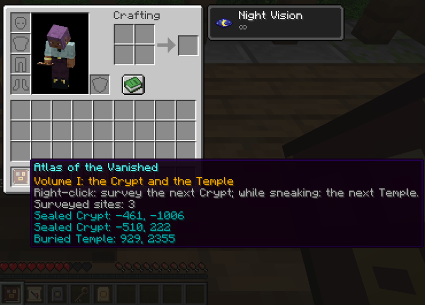

[Accueil](../README.md) · **Guide** · [Ruines](ruines.md) · [Relevé et Atlas](releve-et-atlas.md) · [Serveur](serveur.md) · [English](../en/guide.md)

# Le guide

## Installer

Minecraft 1.21.1, NeoForge 21.1.265 ou plus récent, Java 21. Le mod s'installe sur le client et sur le serveur, et ne demande aucun autre mod. Il est en anglais et en français ; en anglais, il s'appelle Atlas of the Vanished.

Les ruines n'apparaissent que dans les chunks générés après l'installation du mod. Sur un monde existant, partez vers des terres inexplorées.

## Les objets

| Objet | D'où il vient | Ce qu'il fait |
|---|---|---|
| Relevé | Coffre de la Tour de Guet | Clic droit : trouve la Crypte Scellée la plus proche et se change en carte |
| Relevé du Temple, affiché « Relevé (Temple) » | Coffre de la Tour de Guet, une fois sur deux | Pareil, pour le Temple Enseveli le plus proche |
| Clé des Disparus | Le trial spawner d'une Crypte Scellée | Ouvre le Vault de la même Crypte |
| Plaque de la crypte | Le Vault d'une Crypte Scellée | Ingrédient de l'Atlas |
| Plaque du temple | Le coffre d'un Temple Enseveli, rarement le sable suspect | Ingrédient de l'Atlas |
| L'Atlas des Disparus | Fabriqué | Trouve des Cryptes et des Temples, encore et encore, et les consigne |

## De la première tour à l'Atlas

1. **Trouver une Tour de Guet.** Une tour de pierre et d'épicéa, en forêt, taïga, plaine, prairie et savane. Grimpez à l'échelle jusqu'à la plate-forme de guet et ouvrez le coffre.
2. **Utiliser le Relevé.** Prenez-le en main et faites un clic droit. La recherche tourne en arrière-plan ; quelques secondes plus tard, le Relevé devient une carte avec une croix rouge sur la Crypte.
3. **Vider la Crypte Scellée.** Descendez l'escalier du mausolée, attention aux plaques de pression du couloir, battez le trial spawner pour obtenir la Clé des Disparus, puis utilisez la clé sur le Vault pour la Plaque de la crypte.
4. **Trouver un Temple Enseveli.** Utilisez le Relevé du Temple si la tour vous en a donné un ; sinon cherchez dans les déserts et les badlands. Lisez le livre du lutrin avant de toucher un levier.
5. **Fabriquer l'Atlas.** Un livre, la Plaque de la crypte et la Plaque du temple, dans n'importe quel ordre, sur une table de craft ou dans la grille de l'inventaire.
6. **Utiliser l'Atlas.** Clic droit pour trouver la prochaine Crypte pas encore consignée, accroupi et clic droit pour le prochain Temple. Chaque recherche ajoute le site au tome et vous donne sa carte. L'Atlas ne s'use jamais.

## Conseils

- Prenez un arc ou un bouclier pour les pièges à flèches, et de quoi manger pour le combat du trial spawner.
- Prenez un pinceau pour le Temple : le sanctuaire a six blocs de sable suspect.
- Un Relevé reste utilisable après une recherche ratée : attendez 10 secondes et réessayez ailleurs.
- L'Atlas porte plus loin que le Relevé : servez-vous-en pour les sites que le Relevé n'a pas trouvés.

Détails : [les ruines](ruines.md), [Relevé et Atlas](releve-et-atlas.md).
