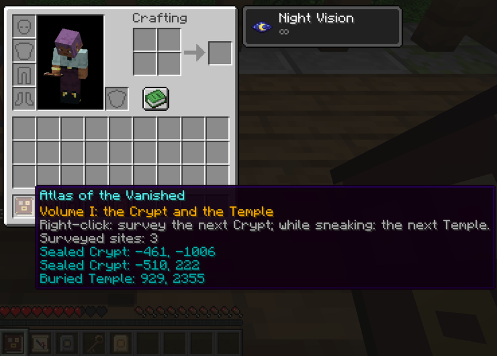

[Accueil](../README.md) · [Guide](guide.md) · [Ruines](ruines.md) · **Relevé et Atlas** · [Serveur](serveur.md) · [English](../en/survey-and-atlas.md)

# Relevé et Atlas

## Le Relevé

On le trouve dans les coffres des Tours de Guet. Un Relevé simple cherche une Crypte Scellée ; celui qui s'appelle « Relevé (Temple) » cherche un Temple Enseveli.

1. Prenez-le en main et faites un clic droit. La barre de messages annonce que la recherche commence.
2. La recherche tourne en arrière-plan, case après case en s'éloignant de l'endroit où vous êtes, sans figer le serveur. Vous pouvez continuer à bouger et à jouer.
3. Quand elle trouve un site, le Relevé se change en carte nommée « Relevé de la Crypte » ou « Relevé du Temple », avec une croix rouge sur le site.

Gardez le Relevé dans votre inventaire pendant la recherche. Si vous le jetez ou le rangez dans un coffre, la recherche est abandonnée et il ne se passe rien.

La carte est une carte vanilla à l'échelle 1:4, centrée sur le site. Elle commence vierge et se remplit à mesure que vous explorez la zone, comme toute carte ; la croix rouge et votre position s'affichent dès le début.

## L'Atlas des Disparus

**Recette (sans forme) :** livre + Plaque de la crypte + Plaque du temple.

L'Atlas utilise la même recherche que le Relevé, avec deux différences :

- **Il ne s'use jamais.** Chaque recherche consigne le site dans le tome et ajoute sa carte à votre inventaire (posée à vos pieds si l'inventaire est plein).
- **Il saute ce qu'il connaît déjà.** Chaque recherche vise la Crypte (ou le Temple) la plus proche qui n'est pas encore consignée dans cet Atlas. Utilisez-le encore et encore pour trouver le site suivant, puis le suivant.

Clic droit : cherche une Crypte ; accroupi et clic droit : cherche un Temple.

Survolez l'Atlas pour lire son registre : le titre « Tome I : la Crypte et le Temple », le mode d'emploi, le nombre de sites relevés, puis chaque site avec ses coordonnées X et Z.

## Portée

La recherche s'éloigne par anneaux de la grille de la structure (voir [la fréquence de chaque ruine](ruines.md)). Une recherche qui atteint le dernier anneau sans rien trouver échoue.

| | Anneaux | Crypte Scellée | Temple Enseveli |
|---|---|---|---|
| Relevé | 16 | environ 10 000 blocs | environ 12 000 blocs |
| Atlas | 24 | environ 15 000 blocs | environ 18 000 blocs |

## Limites

| Règle | Valeur |
|---|---|
| Recherches en même temps, par joueur | 1 |
| Recherches en même temps, sur tout le serveur | 4 |
| Durée maximale d'une recherche avant abandon | 150 secondes |
| Attente après une recherche ratée | 10 secondes |

Une recherche ratée ne vous coûte jamais l'objet : vous gardez le Relevé ou l'Atlas et pouvez réessayer après l'attente. Quand le serveur fait déjà 4 recherches, la vôtre est refusée tout de suite, sans attente.

## Messages

| Message | Sens |
|---|---|
| Le Relevé cherche la Crypte la plus proche… | La recherche a commencé |
| Relevé achevé : la Crypte est portée sur la carte. | Trouvée ; le Relevé est maintenant une carte |
| L'Atlas consigne une nouvelle Crypte ; sa carte rejoint votre sac. | Trouvée ; le site est dans l'Atlas |
| Un relevé est déjà en cours. | Vous avez déjà une recherche en cours |
| Les relevés sont saturés ; réessayez plus tard. | Le serveur fait déjà 4 recherches |
| Le Relevé doit encore attendre. | Vous êtes encore dans l'attente de 10 secondes |
| Aucune Crypte à portée du Relevé. | Rien dans les anneaux ; essayez ailleurs, ou utilisez l'Atlas |
| Le Relevé n'a pas abouti à temps. | La recherche a duré plus de 150 secondes |
| Aucune Crypte ne peut exister dans ce monde. | Cette dimension n'a pas de Cryptes (le Nether, l'End, un monde qui n'en a pas) |

Les messages du Temple sont les mêmes, avec « Temple » à la place de « Crypte ».
