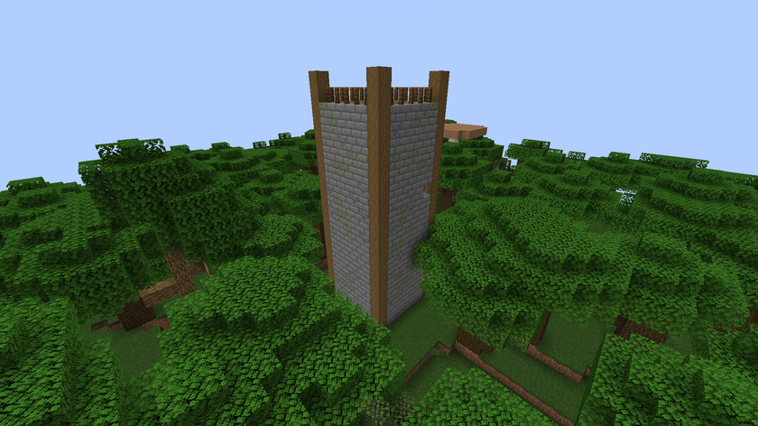
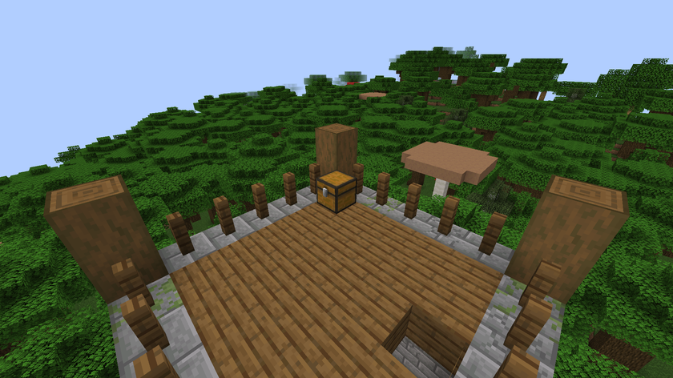
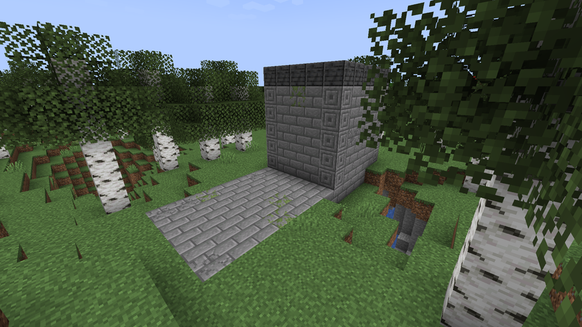
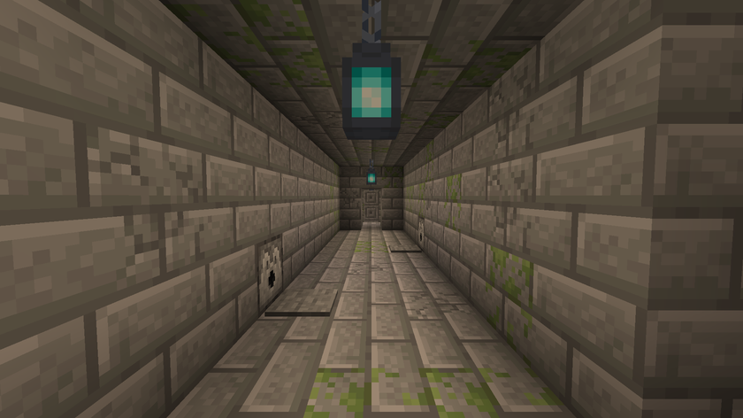
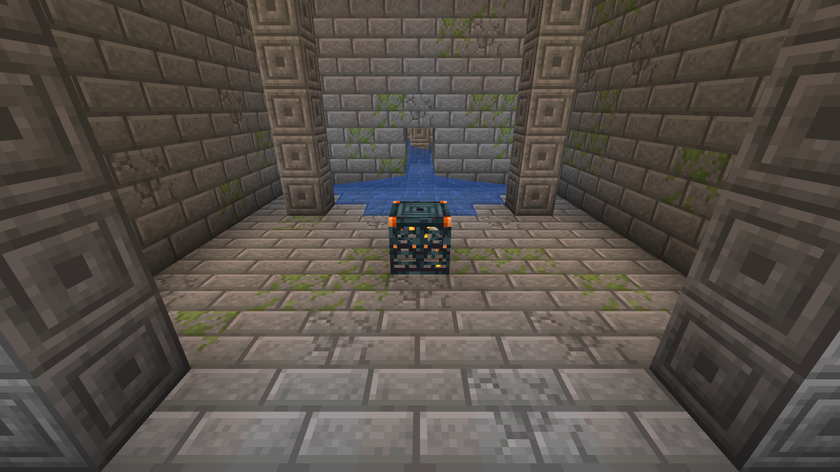
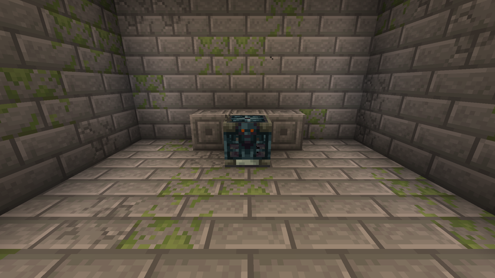
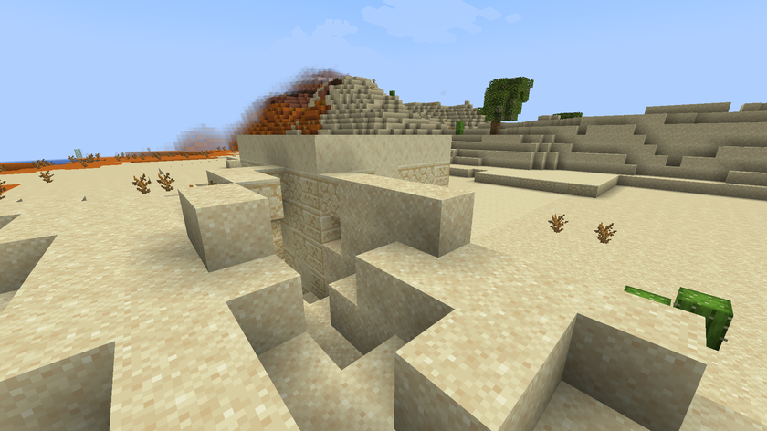
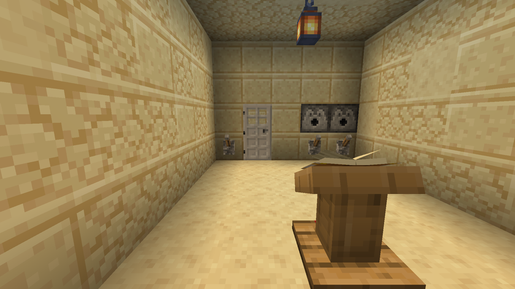
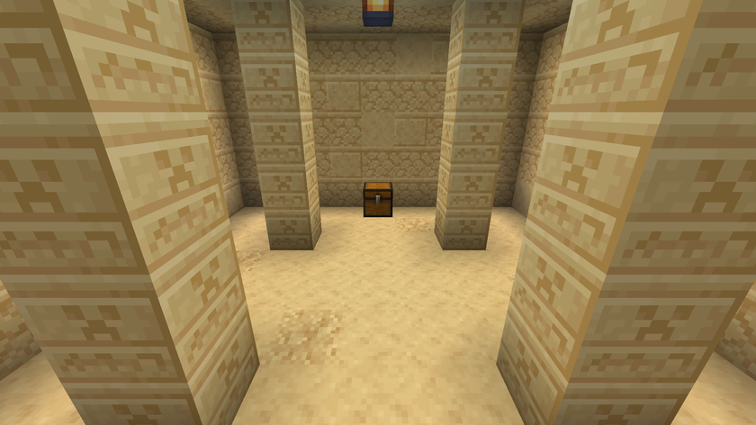

[Accueil](../README.md) · [Guide](guide.md) · **Ruines** · [Relevé et Atlas](releve-et-atlas.md) · [Serveur](serveur.md) · [English](../en/ruins.md)

# Les ruines

Les trois ruines se génèrent dans l'Overworld, dans les chunks neufs seulement. « Environ une tous les N chunks » veut dire que le monde est découpé en carrés de N × N chunks, et que chaque carré peut accueillir un site si le biome convient.

Dans les tables de butin ci-dessous, le poids est la part de chaque ligne : une ligne de poids 4 sort quatre fois plus souvent qu'une ligne de poids 1 dans le même tirage.

## Tour de Guet

- **Où :** forêts, taïgas, plaines, plaines de tournesols, prairies et savanes.
- **Fréquence :** environ une tous les 32 chunks, au moins 10 chunks d'écart.
- **Dedans :** une échelle jusqu'à la plate-forme de guet, avec un coffre.

### Coffre de guet

| Objet | Nombre | Chance |
|---|---|---|
| Relevé | 1 | toujours |
| Relevé du Temple | 1 | une fois sur deux |

Plus 2 à 4 tirages parmi :

| Objet | Nombre | Poids |
|---|---|---|
| Pain | 1 à 3 | 4 |
| Flèches | 4 à 12 | 3 |
| Torches | 4 à 8 | 3 |
| Longue-vue | 1 | 1 |
| Boussole | 1 | 1 |

## Crypte Scellée

- **Où :** les mêmes biomes que la Tour de Guet, jamais à moins de 4 chunks d'un village.
- **Fréquence :** environ une tous les 40 chunks, au moins 14 chunks d'écart.
- **Plan :** six salles à la suite, toujours dans le même ordre.

| # | Salle | Ce qu'on y trouve |
|---|---|---|
| 1 | Mausolée | Un petit bâtiment de pierre en surface ; l'escalier descend de 8 blocs |
| 2 | Couloir piégé | Deux plaques de pression en pierre, chacune reliée à un distributeur de 16 flèches |
| 3 | Coude descendant | Le passage tourne et descend de 2 blocs |
| 4 | Salle du trial spawner | Quatre piliers et le trial spawner |
| 5 | Antichambre | Encore une plaque de pression et un distributeur de flèches |
| 6 | Salle du Vault | Le Vault qui garde la Plaque de la crypte |

### Le trial spawner

| Réglage | Valeur |
|---|---|
| Monstres | squelettes (poids 3) et zombies (poids 2) |
| Monstres en tout | 6, plus 2 par joueur en plus |
| En même temps | 2, plus 1 par joueur en plus |
| Temps entre deux apparitions | 2 secondes |
| Se réveille quand un joueur est à moins de | 14 blocs |
| Recharge après un combat | 30 minutes |
| Récompense | 1 Clé des Disparus |

C'est un trial spawner vanilla avec ces réglages : battez tous les monstres de la vague et il éjecte la clé.

### Le Vault

Utilisez la Clé des Disparus sur le Vault. C'est un Vault vanilla : chaque joueur peut l'ouvrir une fois.

| Objet | Nombre | Chance |
|---|---|---|
| Plaque de la crypte | 1 | toujours |

Plus 2 à 3 tirages parmi :

| Objet | Nombre | Poids |
|---|---|---|
| Émeraudes | 2 à 4 | 5 |
| Lingots de fer | 2 à 4 | 4 |
| Carottes dorées | 2 à 4 | 3 |
| Os | 3 à 6 | 3 |
| Diamants | 1 à 2 | 1 |

## Temple Enseveli

- **Où :** déserts et badlands.
- **Fréquence :** environ un tous les 48 chunks, au moins 16 chunks d'écart.
- **Plan :** un pavillon de grès à demi enseveli, un escalier qui descend de 5 blocs, puis deux salles.

### La salle de l'énigme

Un lutrin porte un livre avec l'indice : page 1 en français, page 2 en anglais. Trois leviers sont fixés au mur à côté d'une porte de fer. Un levier ouvre la porte ; chacun des deux autres déclenche un distributeur de 16 flèches.

Solution (à ne pas lire si vous voulez chercher)

L'indice dit : « Ceux qui entrent face au levant ne tirent que de la main gauche. » Face aux leviers, tirez celui de gauche.

### Le sanctuaire

Six blocs de sable suspect dans le sol, et un coffre.

Sable suspect, un objet par bloc :

| Objet | Poids |
|---|---|
| Pépite d'or | 4 |
| Tesson de poterie d'archer | 2 |
| Tesson de poterie de joyau | 2 |
| Tesson de poterie de crâne | 2 |
| Émeraude | 2 |
| Plaque du temple | 1 |

Coffre :

| Objet | Nombre | Chance |
|---|---|---|
| Plaque du temple | 1 | toujours |

Plus 3 à 5 tirages parmi :

| Objet | Nombre | Poids |
|---|---|---|
| Lingots d'or | 2 à 5 | 4 |
| Émeraudes | 2 à 4 | 3 |
| Lapis-lazuli | 4 à 9 | 3 |
| Os | 2 à 6 | 3 |
| Pinceau | 1 | 2 |
| Diamants | 1 à 2 | 1 |
